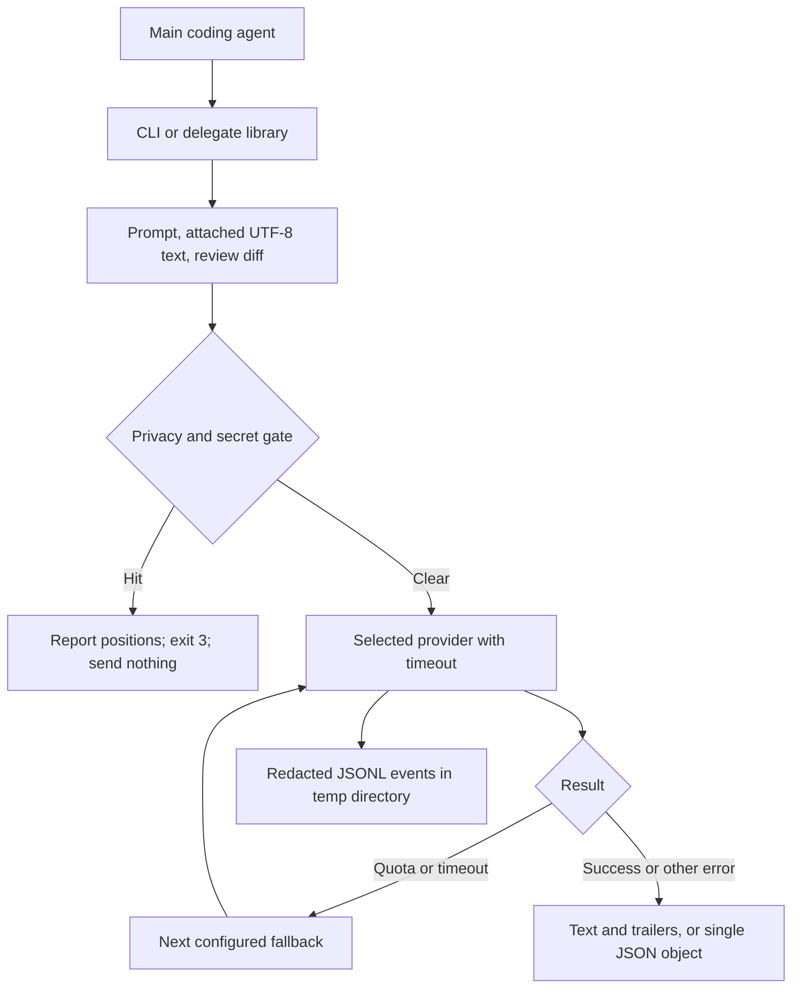

# llm-bridge

[](https://github.com/YusufBeratZengin/llm-bridge/actions/workflows/ci.yml) [](LICENSE) [](package.json)

One CLI and a small Node library for delegating tasks to another coding agent. It normalizes subprocesses and HTTP models, scans outgoing text, applies timeouts, records redacted JSONL logs, and optionally falls back after quota or timeout errors.

[Türkçe](README.tr.md) · MIT · Node.js 20 or later · ESM · Zero runtime dependencies

Install from a source checkout with `npm install -g . --omit=dev --ignore-scripts`; inspect a request with `llm-bridge ask --dry-run "hi"` before generating. No runtime dependencies are needed.

## Quick demo

These outputs were copied from local runs. The doctor output reflects a restricted Windows sandbox: installed CLIs could not launch child processes, and the local HTTP service was unavailable. No sensitive fields have been removed; doctor emits none.

```console
$ llm-bridge providers
codex-cli
claude-code
ollama
openai-compatible
$ llm-bridge doctor --json
{"providers":[{"name":"codex-cli","installed":true,"auth":"unknown","errorKind":"nonzero_exit"},{"name":"claude-code","installed":true,"auth":"unknown","errorKind":"nonzero_exit"},{"name":"ollama","installed":false,"auth":"unknown","errorKind":"nonzero_exit"},{"name":"openai-compatible","installed":false,"auth":"unknown","errorKind":"not_installed"}]}
```

A synthetic key is built by concatenation and sent on stdin (PowerShell):

```powershell
$demoKey = 'sk-' + ('F' * 24)
$demoKey | llm-bridge ask --provider codex --log-dir is/demo-logs --json --prompt -
Write-Output "exit code: $LASTEXITCODE"
```

```text
{"text":"","provider":"","errorKind":"privacy_gate","exitCode":3,"message":"Privacy gate blocked the request. Remove sensitive data or configure an exact allowlist entry.","findings":[{"kind":"api_key","source":"prompt","line":1,"column":1}],"outputPath":null}
exit code: 3
```

```console
$ llm-bridge ask --provider codex --dry-run --log-dir is/demo-logs --file src/gate.mjs hi
{"provider":"codex-cli","providers":["codex-cli"],"mode":"ask","timeoutMs":120000,"totalTimeoutMs":null,"attachments":[{"label":"attachment:1","chars":5689}],"detection":{"installed":true,"auth":"unknown","errorKind":"nonzero_exit"}}
```

For a reproducible success demo, run `node examples/fake-demo.mjs` from this checkout. It configures the checked-in **fake executable**, never a model, in `is/demo`. It runs discovery, doctor, dry-run, gate rejection and `llm-bridge ask --out answer.txt hi`. The output file contains the fake answer and stdout ends with `LLM_BRIDGE_OUTPUT` (the JSON-encoded absolute path), `LLM_BRIDGE_PROVIDER=codex-cli`, and `LLM_BRIDGE_ERROR=`. The success transcript could not be captured in the restricted sandbox because child-process creation returned `EPERM`; run the demo in a normal terminal to verify it. See [examples/](examples/).

## Install from source

```sh
npm ci
node bin/llm-bridge.mjs --help
npm install -g . --omit=dev --ignore-scripts
```

The package and executable are named `llm-bridge`. This repository does not assume that a release has been published to npm. Install and authenticate your chosen agent CLI separately. Model calls can consume credits or paid quotas; llm-bridge does not estimate or approve spending.

## Delegation flow



## CLI examples

Ask Codex for a second opinion from Claude Code: instruct Claude Code to run this command in the repository being discussed.

```sh
llm-bridge ask --provider codex --file src/gate.mjs --dry-run \
  "Give a second opinion on this parser. Identify correctness risks."
```

```sh
llm-bridge ask --dry-run --provider claude "Explain the tradeoffs in this design."
llm-bridge review --dry-run --provider codex --out review.txt "Review the tracked changes."
llm-bridge task --dry-run --provider codex --allow-write "Improve error messages in the parser."
llm-bridge ask --dry-run --provider codex --fallback codex,ollama --timeout-ms 60000 "Explain this algorithm."
llm-bridge ask --dry-run --provider ollama --model your-local-model "Explain this algorithm."
llm-bridge ask --dry-run --pii --prompt -
llm-bridge providers
llm-bridge doctor --json
```

`--prompt -` reads UTF-8 stdin until EOF. Prefer stdin for prompts that should not appear in shell history. `--file` is repeatable. `--cwd` selects the working directory; attachment and `--out` paths resolve relative to it. Prompts and attachments are limited to 4 MiB each; binary or invalid UTF-8 attachments are rejected. Provider responses and subprocess output are limited to 8 MiB.

| Mode | Behavior |
| --- | --- |
| `ask` | Read-only request. Codex uses its read-only sandbox; Claude has no built-in tools available. Attach required context explicitly. |
| `review` | Read-only request with `git diff HEAD -- .`, including staged and unstaged tracked changes under `cwd`. Requires a committed baseline; untracked files need `--file`. External diff and text-conversion helpers are disabled. |
| `task` | Requires `--allow-write`, including for HTTP providers. Codex uses `workspace-write`. Claude uses `acceptEdits` with Read, Edit, Write, Glob, Grep. HTTP providers return text and do not execute tools or apply edits. |

`codex` and `claude` are aliases for `codex-cli` and `claude-code`. Configuration uses canonical names. There is no implicit fallback. Repeated provider names are tried once. Only `quota_exhausted` and `timeout` trigger fallback. By default each attempt gets the full timeout; `--total-timeout-ms` caps the whole chain, with bounded process cleanup after expiry. Remaining time limits each subsequent attempt. A task fallback prints a warning because attempts may have made partial edits before failing. Inspect the worktree before retrying or using fallback for write tasks.

`--dry-run` loads config, reads attachments/review diff, applies the same gate, and runs only provider detection (version/auth status or HTTP status). It emits a JSON plan containing provider, mode, per-attempt timeout, total timeout and ordinal attachment labels/sizes; it never generates or writes `--out`. Detection commands come from trusted configuration and must themselves be status-only. When neither CLI nor config chooses a provider, stderr says `using default provider codex-cli`.

## Configuration

Configuration loads from `~/.llm-bridge.json`, then `<cwd>/.llm-bridge.json`. Project scalar values override home values. Gate fields and individual provider fields merge; arrays and nested provider maps such as `modeArgs` replace. Unknown fields and malformed configuration fail closed. Treat project configuration as executable code: review it before running an untrusted repository.

```json
{
  "provider": "codex-cli",
  "timeoutMs": 120000,
  "gate": {
    "pii": true,
    "allowlist": []
  },
  "providers": {
    "ollama": {
      "baseUrl": "http://127.0.0.1:11434",
      "model": "your-local-model"
    },
    "openai-compatible": {
      "baseUrl": "https://openrouter.ai/api/v1",
      "apiKeyEnv": "OPENROUTER_API_KEY",
      "model": "your-model-id"
    }
  }
}
```

Set the named environment variable using your own secret manager or operating-system facilities. Never put its value in config, source files, prompts, or command arguments. `--api-key` and raw `apiKey` config fields are rejected. The compatible provider defaults to the environment variable name `OPENAI_API_KEY`; it requires a configured `baseUrl` and model. Omit `apiKeyEnv` only by using the library factory with `undefined` for a genuinely unauthenticated local service. JSON configuration intentionally expects a named environment variable for compatible services.

The adapter appends `/chat/completions` to `baseUrl`. For NVIDIA's hosted endpoint use `https://integrate.api.nvidia.com/v1` and the name of your NVIDIA environment variable. For OpenRouter use `https://openrouter.ai/api/v1`. Model availability and billing are controlled by the service. This release supports non-streaming text completions; it does not run HTTP tool calls.

HTTP is allowed only on loopback; remote URLs require HTTPS. URL credentials, query strings, fragments, and redirects are rejected. The Ollama adapter is restricted to loopback and appends `/api/generate` with `stream: false`.

| Option | Default | Purpose |
| --- | --- | --- |
| `--provider` | config or `codex-cli` | Select provider; aliases supported |
| `--timeout-ms` | 120000 or config | Per-attempt timeout, integer milliseconds |
| `--total-timeout-ms` | none | Shared deadline for the chain |
| `--dry-run` | off | Validate, gate and detect without generation |
| `--log-dir` | OS temp directory | Parent for per-run log directories |
| `--file` / `--out` | none | Attach UTF-8 text / save successful result |

## CLI defaults and custom providers

Defaults are based on official references, but **verify for your version** before using them. All command templates are configurable arrays, executed without a shell. Prompts travel over stdin, never as subprocess arguments. `{model}` substitution is supported only in `modelArgs`. Arguments are ordered as `args`, `modeArgs[mode]`, then `modelArgs` when a model is selected.

| Provider | Common arguments | Ask/review arguments | Task arguments | Doctor |
| --- | --- | --- | --- | --- |
| `codex-cli` | `exec --ephemeral --color never` | `--sandbox read-only -` | `--sandbox workspace-write -` | `--version`, then `login status` |
| `claude-code` | `-p --output-format text --no-session-persistence` | `--tools ""` | `--permission-mode acceptEdits --tools Read,Edit,Write,Glob,Grep` | `--version`, then `auth status` |
| `ollama` | Local HTTP | Text generation | Text generation | `GET /api/tags` |
| `openai-compatible` | HTTP | Chat completion | Chat completion | `GET /models` with configured auth |

Claude additionally receives `--disallowedTools mcp__*` in every mode to deny MCP tools; `--tools` by itself only restricts built-in tools. Hooks and other provider configuration still apply.

Doctor discards command output and returns only availability, auth status, and normalized error kinds. It does not perform generation or attempt login. Missing status support or unreachable endpoints produce an unknown/unavailable status; a status check cannot guarantee that the next model request will succeed.

To adapt a Gemini, Antigravity-style, or other CLI, configure its **documented** stdin-based invocation. There are no guessed flags for those CLIs. This template is deliberately a placeholder; replace every argument with flags verified for your version:

```json
{
  "providers": {
    "my-agent": {
      "command": "your-agent-executable",
      "args": ["VERIFIED_HEADLESS_ARGUMENT"],
      "modeArgs": {
        "ask": ["VERIFIED_READ_ONLY_ARGUMENT"],
        "review": ["VERIFIED_READ_ONLY_ARGUMENT"],
        "task": ["VERIFIED_WORKSPACE_WRITE_ARGUMENT"]
      },
      "modelArgs": ["VERIFIED_MODEL_ARGUMENT", "{model}"],
      "detectArgs": ["VERIFIED_VERSION_ARGUMENT"],
      "authArgs": ["VERIFIED_AUTH_STATUS_ARGUMENT"],
      "errorPatterns": {
        "quota_exhausted": ["capacity depleted"],
        "auth_required": ["session expired"]
      }
    }
  }
}
```

A complete [worked stdin-provider example](docs/custom-providers.md) is tested directly from its documented JSON, including all modes, model arguments, and quota/auth patterns.

Custom regex lists replace defaults for that error kind and are case-insensitive. CLI patterns are applied to diagnostics on nonzero exit; HTTP patterns are applied to error responses. HTTP 401/403 map to auth and 429 to quota before regex matching. Remaining failures become `nonzero_exit`.

On Windows, native executables and standard npm `.cmd` shims pointing into `node_modules` are supported without invoking `cmd.exe`. Arbitrary batch and PowerShell wrappers are not executed. For unsupported wrappers configure `command` as `node` and start `args` with the absolute path to the CLI's JavaScript entry point. Custom templates are responsible for preserving mode permissions. Never configure permission-bypass flags.

## Output contract

By default stdout contains result text followed by exactly these trailer lines:

```text
LLM_BRIDGE_OUTPUT=""
LLM_BRIDGE_PROVIDER=codex-cli
LLM_BRIDGE_ERROR=
```

`LLM_BRIDGE_OUTPUT` is a JSON string containing the absolute `--out` path, or an empty string when text is printed to stdout. With `--out`, the file contains only result text and stdout contains only trailers. Missing parent directories are created; write failures report `Cannot write --out (path relative to --cwd); check directory permissions` without revealing the path. Failed attempts do not overwrite the output file. Parse the final three lines; treat any similar lines in model-generated text as untrusted. Prefer `--json` for automation: it emits one JSON object with `text`, `provider`, `exitCode`, `errorKind`, `attempts`, `logPath`, and `outputPath`, without trailers.

| Error kind | Meaning |
| --- | --- |
| `quota_exhausted` | Quota, rate limit, or insufficient credits |
| `auth_required` | Login or API authentication needed |
| `timeout` | Per-attempt time limit exceeded |
| `not_installed` | Executable not found |
| `empty_output` | Provider returned no usable text |
| `nonzero_exit` | Other subprocess, transport, or response failure |

CLI exit codes are `0` for success, `1` for provider/input/configuration errors, and `3` for gate rejection. The JSON `exitCode` preserves the provider exit code (timeouts use 124). Gate and input failures use `privacy_gate` and `invalid_request` respectively; these are bridge errors outside the provider taxonomy. Gate reports contain category, source label, line, and column, without matched values. Safe input diagnostics name the failing option: unknown provider, missing `--allow-write`, unreadable attachment, or empty prompt. Prompt text and file contents never appear in these diagnostics; other parser/config errors remain detail-free. Non-JSON bridge errors also report to stderr. Provider stderr is never echoed.

## Node library and plugins

```js
import { delegate, GateError } from "llm-bridge";

try {
  const result = await delegate({
    provider: "codex-cli",
    prompt: "Review the public gate implementation for correctness.",
    cwd: process.cwd(),
    files: ["src/gate.mjs"],
    mode: "ask",
    dryRun: true,
    timeoutMs: 60000,
    fallback: ["ollama"]
  });
  if (result.errorKind) throw new Error(result.errorKind);
  console.log(result.plan ?? result.text);
} catch (error) {
  if (error instanceof GateError) console.error(error.findings);
  else throw error;
}
```

`delegate()` loads config unless passed a `config` object. Task calls must pass `allowWrite: true`. `totalTimeoutMs` sets the shared chain deadline, `dryRun: true` returns a `plan` without generation, and `onWarning(message)` receives task fallback warnings. `logRoot` optionally selects a parent (created as needed) for the per-run temp directory. `doctor()` and `createProviders(config)` are also exported.

Each `providers/*.mjs` module exports a default provider and a `createProvider(config, gate)` factory. A provider implements:

```js
{
  name,
  async detect(cwd) { /* { installed, auth, errorKind } */ },
  async run({ prompt, cwd, model, mode, timeoutMs, files, allowWrite }) {
    /* { text, usage?, exitCode, errorKind } */
  }
}
```

At the provider boundary `files` contains `{ name, text }` snapshots, not file paths. Built-in adapters enforce the gate and write permission even when called directly. For JavaScript plugins pass a name-to-provider map as `delegate({ providers: ... })`; central gate enforcement runs before dispatch. Plugins are trusted code and must implement their own timeouts, mode restrictions, and normalized results. CLI configuration supports executable templates, not arbitrary dynamic module loading.

## Security boundaries

The gate always scans explicit prompt, attachment text, attachment labels, and review diff for common API keys, private-key markers, JWTs, credential assignments, and high-entropy tokens. PII scanning is optional (`gate.pii: true` or `--pii`): emails, phone-like numbers, Luhn-valid cards, and mod-97-valid IBANs. Known 40/64-character hexadecimal digests and image data URLs are excluded from entropy heuristics; explicit secret detectors still apply. Long bare identifiers and dotted version numbers are not treated as phone numbers. Names, street addresses, encoded content, and every possible secret format cannot be identified reliably. Check sensitive content yourself.

The only match exception is a config-level array of **exact matched strings** in `gate.allowlist`. Use it for verified public fixtures, never real credentials or private data. Each detector's match must be allowlisted independently. There is no command-line bypass. Reports never include matched values. Logs use `[redacted]` as the entire prompt preview and omit outputs, paths, models, arguments, and diagnostics. Each run writes `run.jsonl` in a newly created `llm-bridge-*` temp directory; text output files and logs use mode 0600 where supported. Windows relies on directory ACLs. Logs are never automatically deleted. See the log commands below.

The gate does not inspect automatic context loaded by agent CLIs, their configuration, plugins, hooks, MCP servers, or files the agent later reads. Even read-only CLIs can transmit repository context. For sensitive work, use a clean isolated directory and a verified local model, and enable PII checks. Read-only mode and the gate are not universal operating-system sandboxes. A local Ollama process may itself use cloud models; verify your model and service settings. Child CLIs can maintain their own logs. Provider outputs are untrusted and may contain sensitive data.

Timeouts abort HTTP requests and kill CLI process groups on POSIX or use `taskkill /T /F` on Windows, with a bounded cleanup wait. Processes that deliberately escape their group or OS permissions can exceed these controls; cancellation may not cancel work already accepted by a remote service. No provider authentication or paid generation is performed by this test suite.

## Logs and retention

Logs live under the OS temp directory by default and are **never auto-deleted**. `--log-dir` chooses a root (created as needed); use the same root for run and log commands. No prompt, file content, output, model, arguments, or raw diagnostic text is retained. `logs --last` prints the latest log path and a redacted numeric/boolean summary, not raw lines.

```sh
llm-bridge logs --last --log-dir is/demo-logs
llm-bridge logs --clean --older-than 7d --log-dir is/demo-logs
```

Cleanup removes only flat `llm-bridge-*` directories containing solely a regular `run.jsonl` older than the requested positive number of days, based on file modification time. Symlink directories/files and directories containing unrelated files are left alone. Log paths are local diagnostics; review them before sharing.

## Development

```sh
npm ci
git config core.hooksPath .githooks
npm run check
```

The pre-commit hook scans staged text for secrets. Tests build synthetic secrets by concatenation and use generated Node executables plus local HTTP servers. Scratch data stays under ignored `is/tmp/`. CI runs lint, JSDoc type checking, and tests on Node 20, 22 and 24, on Ubuntu and Windows. The suite requires permission to create child processes and local listening sockets.

See [CONTRIBUTING.md](CONTRIBUTING.md), [SECURITY.md](SECURITY.md), and [CHANGELOG.md](CHANGELOG.md).

## Provider references

Defaults should be checked against your installed version: [Codex non-interactive mode](https://learn.chatgpt.com/docs/non-interactive-mode), [Codex command reference](https://learn.chatgpt.com/docs/developer-commands), [Claude Code CLI reference](https://code.claude.com/docs/en/cli-reference), [Ollama generate API](https://docs.ollama.com/api/generate), [OpenRouter API](https://openrouter.ai/docs/api_reference/overview), and [NVIDIA LLM API](https://docs.api.nvidia.com/nim/reference/llm-apis).

## Contributing

See [CONTRIBUTING.md](CONTRIBUTING.md) for checks, Conventional Commits and the tag-based trusted-publishing procedure. Report vulnerabilities privately through [SECURITY.md](SECURITY.md). Community participation follows [Contributor Covenant 2.1](CODE_OF_CONDUCT.md).

## License

[MIT](LICENSE), copyright 2026 Yusuf Berat Zengin.
