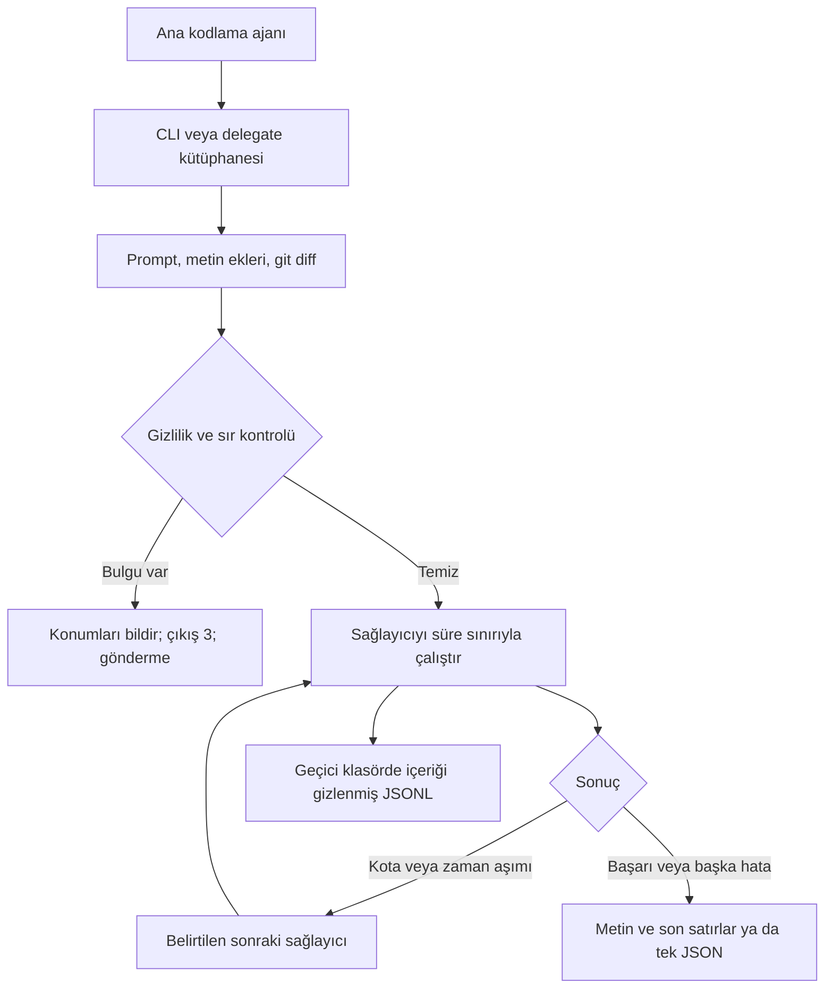

# llm-bridge

Bir kodlama ajanından diğerine görev aktarmak için tek komut satırı aracı ve küçük bir Node kütüphanesi. Farklı CLI ve HTTP servislerini ortak bir arayüzde toplar; gönderilecek metni tarar, süre sınırı uygular, içeriği gizlenmiş JSONL kayıtları tutar ve istenirse kota veya zaman aşımı hatasında sıradaki sağlayıcıya geçer.

[English](README.md) · MIT · Node.js 20 ve üzeri · ESM · Çalışma anında ek bağımlılık yok

## Kaynaktan kurulum

```sh
npm ci
node bin/llm-bridge.mjs --help
npm install -g . --omit=dev --ignore-scripts
```

Paketin ve komutun adı `llm-bridge`. Bu depo, paketin npm'de yayımlandığını varsaymaz. Kullanacağınız ajanı ayrıca kurup kendi hesabınızla giriş yapın. Model çağrıları ücret veya kota tüketebilir; llm-bridge maliyet hesaplamaz ve harcama onayı vermez.

## Akış



## Kullanım

Claude Code içinden Codex'e ikinci görüş sordurmak için, Claude Code'a ilgili depoda şu komutu çalıştırmasını söyleyin:

```sh
llm-bridge ask --provider codex --file src/parser.mjs --json \
  "Bu ayrıştırıcıyı doğruluk açısından incele. Olası hataları belirt."
```

```sh
llm-bridge ask --provider claude "Bu tasarımın artılarını ve eksilerini açıkla."
llm-bridge review --provider codex --out review.txt "Değişiklikleri incele."
llm-bridge task --provider codex --allow-write "Ayrıştırıcının hata mesajlarını iyileştir."
llm-bridge ask --provider codex --fallback codex,ollama --timeout-ms 60000 "Algoritmayı açıkla."
llm-bridge ask --provider ollama --model your-local-model "Algoritmayı açıkla."
llm-bridge ask --pii --prompt -
llm-bridge providers
llm-bridge doctor --json
```

`--prompt -`, UTF-8 metni standart girdiden dosya sonuna kadar okur. Prompt'un kabuk geçmişine girmemesi için bu yolu kullanın. `--file` birden fazla kez verilebilir. `--cwd` çalışma dizinini seçer; eklerin ve `--out` dosyasının göreli yolları bu dizine göre çözülür. Her prompt ve metin eki en fazla 4 MiB olabilir. İkili dosyalar ve bozuk UTF-8 reddedilir. Sağlayıcı yanıtı ve alt süreç çıktısı 8 MiB ile sınırlıdır.

| Mod | Davranış |
| --- | --- |
| `ask` | Salt okunur istek. Codex `read-only` sandbox kullanır. Claude'un yerleşik araçları kapalıdır; gereken bağlamı açıkça ekleyin. |
| `review` | Salt okunur istekle birlikte `git diff HEAD -- .` gönderir. Çalışma dizini altındaki takip edilen dosyaların staged ve unstaged değişikliklerini kapsar. En az bir başlangıç commit'i gerekir. Takip edilmeyen dosyaları `--file` ile ekleyin. Harici diff ve metin dönüştürme yardımcıları çalıştırılmaz. |
| `task` | Açıkça `--allow-write` gerektirir. Codex `workspace-write` kullanır. Claude `acceptEdits` ile Read, Edit, Write, Glob, Grep araçlarını kullanır. HTTP sağlayıcıları yalnızca metin döndürür; araç çalıştırmaz ve dosya değiştirmez. |

`codex` ve `claude`, sırasıyla `codex-cli` ve `claude-code` kısaltmalarıdır. Ayar dosyasında tam adları kullanın. Kendiliğinden başka sağlayıcıya geçilmez. `--fallback` yalnızca `quota_exhausted` veya `timeout` sonrasında devreye girer; tekrarlanan adlar bir kez denenir. Her denemenin ayrı süre sınırı vardır. Yazma görevleri hata vermeden önce bazı dosyaları değiştirmiş olabilir; tekrar denemeden önce çalışma ağacını kontrol edin.

## Ayarlar

Önce `~/.llm-bridge.json`, ardından `<cwd>/.llm-bridge.json` okunur. Proje değerleri önceliklidir. Gizlilik alanları ve aynı sağlayıcının alanları birleştirilir; diziler ve `modeArgs` gibi iç haritalar bütünüyle değiştirilir. Bilinmeyen alanlar veya bozuk JSON işlemi durdurur. Proje ayarlarını çalıştırılabilir kod gibi değerlendirin; güvenmediğiniz bir depoda önce okuyun.

```json
{
  "provider": "codex-cli",
  "timeoutMs": 120000,
  "gate": {
    "pii": true,
    "allowlist": []
  },
  "providers": {
    "ollama": {
      "baseUrl": "http://127.0.0.1:11434",
      "model": "your-local-model"
    },
    "openai-compatible": {
      "baseUrl": "https://openrouter.ai/api/v1",
      "apiKeyEnv": "OPENROUTER_API_KEY",
      "model": "your-model-id"
    }
  }
}
```

`apiKeyEnv` anahtarın kendisini değil, ortam değişkeninin adını alır. Değeri işletim sistemi veya kendi sır yöneticiniz üzerinden tanımlayın; dosyaya, prompt'a ya da komut argümanlarına yazmayın. `--api-key` ve doğrudan `apiKey` ayarı reddedilir. OpenAI uyumlu sağlayıcıda varsayılan ortam değişkeni adı `OPENAI_API_KEY` olur; `baseUrl` ve model ayrıca gereklidir. Kimlik doğrulaması olmayan yerel bir servis için kütüphane fabrikasında `apiKeyEnv: undefined` kullanılabilir; JSON ayarları bu sağlayıcı için bir ortam değişkeni adı bekler.

OpenAI uyumlu adaptör `baseUrl` sonuna `/chat/completions` ekler. NVIDIA için `https://integrate.api.nvidia.com/v1`, OpenRouter için `https://openrouter.ai/api/v1` kullanılır. Model erişimi ve ücretlendirme servise bağlıdır. Bu sürüm akışsız metin yanıtını destekler; HTTP üzerinden araç çağrısı yürütmez.

HTTP yalnızca loopback adreslerinde kabul edilir; uzak servisler HTTPS kullanmalıdır. URL içinde kullanıcı bilgisi, sorgu veya fragment bulunamaz; yönlendirmeler izlenmez. Ollama adaptörü yalnızca loopback üzerinde çalışır ve `/api/generate` isteğinde `stream: false` gönderir.

## Sağlayıcılar ve komut şablonları

Varsayılanlar resmî belgelere dayanır; yine de **kendi sürümünüz için doğrulayın**. Komutlar dizi olarak ayarlanır ve kabuk açılmadan çalıştırılır. Prompt, alt sürecin argümanları yerine standart girdisine yazılır. Argüman sırası `args`, `modeArgs[mod]`, model seçildiyse `modelArgs` şeklindedir. `{model}` yalnızca `modelArgs` içinde değiştirilir.

| Sağlayıcı | Varsayılan davranış | Doctor |
| --- | --- | --- |
| `codex-cli` | `exec --ephemeral --color never`; moduna göre `--sandbox read-only -` veya `--sandbox workspace-write -` | `--version`, ardından `login status` |
| `claude-code` | `-p --output-format text --no-session-persistence`; ask/review için `--tools ""`; task için `--permission-mode acceptEdits --tools Read,Edit,Write,Glob,Grep` | `--version`, ardından `auth status` |
| `ollama` | Yerel HTTP ile metin üretimi | `GET /api/tags` |
| `openai-compatible` | HTTP ile sohbet tamamlaması | Ayarlı kimlikle `GET /models` |

Claude'a tüm modlarda ayrıca `--disallowedTools mcp__*` verilir. `--tools` yalnızca yerleşik araçları sınırlar; bu ek ayar MCP araçlarını da engeller. Hook'lar ve diğer sağlayıcı ayarları geçerliliğini korur.

Doctor ham çıktıyı göstermez; yalnızca erişilebilirlik, giriş durumu ve hata türünü döndürür. Model çağırmaz, giriş yapmaya çalışmaz. Durum komutu desteklenmiyorsa veya servis erişilemiyorsa durum bilinmiyor/erişilemiyor olarak görünür. Bu kontrol bir sonraki üretim isteğinin çalışacağını garanti etmez.

Gemini, Antigravity tarzı veya başka bir CLI için doğruladığınız stdin tabanlı komut şablonunu ekleyin. Bu araçlar için tahmin edilmiş bayraklar yoktur. Özel sağlayıcıda `command` ve kullanacağınız her mod için `modeArgs` gereklidir. `args`, `modelArgs`, `detectArgs`, `authArgs` ve `errorPatterns` da ayarlanabilir. Tam şablon [İngilizce README](README.md#cli-defaults-and-custom-providers) içinde bulunur. Sürümünüzün belgelerinde doğrulamadan yer tutucu argümanları kullanmayın.

Özel hata regex'leri büyük/küçük harfe duyarsızdır ve ilgili hata türünün varsayılan listesini değiştirir. CLI regex'leri sıfır dışı çıkışın tanı metnine, HTTP regex'leri hata yanıtına uygulanır. HTTP 401/403 giriş, 429 kota hatasıdır. Diğer hatalar `nonzero_exit` olur.

Windows'ta yerel çalıştırılabilir dosyalar ve `node_modules` altındaki JavaScript girişine işaret eden standart npm `.cmd` dosyaları kabuk açılmadan desteklenir. Genel batch ve PowerShell sarmalayıcıları çalıştırılmaz. Gerekirse `command` değerini `node`, `args` dizisinin ilk elemanını CLI'ın JavaScript giriş dosyasının tam yolu yapın. Özel şablonların okuma/yazma izinlerini korumak sizin sorumluluğunuzdadır; izinleri atlayan bayraklar eklemeyin.

## Çıktı ve hatalar

Normal çıktıda yanıtın ardından şu üç satır gelir:

```text
LLM_BRIDGE_OUTPUT=""
LLM_BRIDGE_PROVIDER=codex-cli
LLM_BRIDGE_ERROR=
```

`LLM_BRIDGE_OUTPUT`, `--out` verildiyse tam dosya yolunu, aksi durumda boş metni içeren bir JSON string'idir. `--out` dosyasında yalnızca yanıt bulunur; stdout yalnızca bu üç satırı içerir. Hatalı sonuç mevcut çıktı dosyasının üzerine yazmaz. Son üç satırı ayrıştırın; model metnindeki benzer satırlara güvenmeyin. Otomasyonda `--json` tercih edin: `text`, `provider`, `exitCode`, `errorKind`, `attempts`, `logPath`, `outputPath` alanlarıyla tek bir JSON nesnesi verir.

Sağlayıcı hata türleri: `quota_exhausted`, `auth_required`, `timeout`, `not_installed`, `empty_output`, `nonzero_exit`. CLI başarıda `0`, sağlayıcı/girdi/ayar hatasında `1`, gizlilik engelinde `3` ile çıkar. JSON içindeki `exitCode` sağlayıcının çıkışını korur; zaman aşımında 124 kullanılır. Köprünün kendi hataları `privacy_gate` ve `invalid_request` olarak bildirilir. JSON kullanılmıyorsa köprü hatası ayrıca stderr'e yazılır; sağlayıcının ham stderr çıktısı gösterilmez.

## Node kütüphanesi

```js
import { delegate, GateError } from "llm-bridge";

try {
  const result = await delegate({
    provider: "codex-cli",
    prompt: "Bu herkese açık ayrıştırıcıyı incele.",
    cwd: process.cwd(),
    files: ["src/parser.mjs"],
    mode: "ask",
    timeoutMs: 60000,
    fallback: ["ollama"]
  });
  if (result.errorKind) throw new Error(result.errorKind);
  console.log(result.text);
} catch (error) {
  if (error instanceof GateError) console.error(error.findings);
  else throw error;
}
```

`config` verilmezse ayar dosyaları yüklenir. Yazma görevinde `allowWrite: true` gerekir. `logRoot`, geçici kayıt klasörünün oluşturulacağı mevcut üst dizini seçer. `doctor()` ve `createProviders(config)` de dışa aktarılır.

Her sağlayıcı modülü varsayılan sağlayıcıyı ve `createProvider(config, gate)` fabrikasını sunar. Arayüz `{ name, detect(cwd), run({ prompt, cwd, model, mode, timeoutMs, files, allowWrite }) }` şeklindedir; `run()` sonucu `{ text, usage?, exitCode, errorKind }` olur. Sağlayıcı sınırında `files`, dosya yolları yerine `{ name, text }` anlık kopyaları içerir. Yerleşik adaptörler doğrudan çağrılsa da gizlilik ve yazma kontrollerini yapar. Kütüphaneye `providers` haritasıyla özel JavaScript sağlayıcıları verilebilir; merkezî kontrol bunlar için de çalışır. Özel sağlayıcıların süre sınırını ve mod izinlerini kendileri uygulaması gerekir.

## Güvenlik sınırları

Prompt, metin ekleri, ek adları ve diff; yaygın API anahtarları, özel anahtar başlıkları, JWT, kimlik bilgisi atamaları ve yüksek entropili dizeler için her zaman taranır. PII kontrolü isteğe bağlıdır: `gate.pii: true` veya `--pii` e-posta, telefon benzeri numara, Luhn doğrulamalı kart ve mod-97 doğrulamalı IBAN taramasını açar. 40/64 karakterlik onaltılık özetler entropi kontrolünden hariçtir. Ad, adres, kodlanmış içerik ve her sır biçimi güvenilir biçimde yakalanamaz; hassas metni ayrıca gözden geçirin.

Tek istisna, ayarlardaki `gate.allowlist` dizisinde yer alan **tam eşleşmelerdir**. Bunu yalnızca doğrulanmış, herkese açık test verileri için kullanın; gerçek anahtarı veya özel veriyi buraya yazmayın. Her tarayıcının eşleşmesi ayrı değerlendirilir. Komut satırından kontrolü atlama seçeneği yoktur. Raporlarda eşleşen değer değil, tür ve satır/sütun konumu bulunur.

Kayıtlarda prompt önizlemesinin tamamı `[redacted]` olur; yanıt, yol, model, argüman ve tanı metni tutulmaz. Her çağrı yeni bir geçici `llm-bridge-*` dizininde `run.jsonl` oluşturur. Dosyalar desteklenen sistemlerde 0600 izniyle açılır; Windows'ta klasör ACL'leri geçerlidir. Eski kayıtları saklama politikanıza göre temizleyin.

Kontrol, ajan CLI'larının kendiliğinden yüklediği depo bağlamını, ayarları, hook'ları, eklentileri, MCP sunucularını ve sonradan okudukları dosyaları kapsamaz. Salt okunur CLI da veriyi dışarı gönderebilir. Hassas işte temiz ve izole bir dizin, doğrulanmış yerel model ve PII kontrolü kullanın. Bu araç genel bir işletim sistemi sandbox'ı değildir. Yerel Ollama servisi de bulut modeli kullanabilir; model ayarınızı kontrol edin. Alt CLI'lar kendi kayıtlarını tutabilir. Model yanıtı güvenilmeyen ve hassas veri içerebilen bir çıktıdır.

Zaman aşımında HTTP isteği iptal edilir; CLI için POSIX süreç grubuna sonlandırma gönderilir, Windows'ta `taskkill /T /F` kullanılır. Temizlik beklemesi sınırlıdır. Bilerek ayrılan süreçler, işletim sistemi izinleri veya uzaktaki servisin zaten kabul ettiği işler bu kontrolü aşabilir. Testler gerçek hesaplara bağlanmaz ve ücretli üretim çağrısı yapmaz.

## Geliştirme

```sh
npm ci
git config core.hooksPath .githooks
npm run check
```

Pre-commit hook, staged metinleri sırlar için tarar. Testler birleştirilerek üretilen sahte sırlar, geçici Node çalıştırılabilirleri ve yerel HTTP sunucuları kullanır. Geçici test dosyaları yok sayılan `is/tmp/` altında kalır. CI; Ubuntu ve Windows'ta Node 20 ve 22 için lint, JSDoc tür kontrolü ve testleri çalıştırır. Test ortamında alt süreç başlatma ve yerel port dinleme izni gerekir.

[Katkı rehberi](CONTRIBUTING.md), [güvenlik politikası](SECURITY.md), [değişiklikler](CHANGELOG.md) ve [resmî sağlayıcı kaynakları](README.md#provider-references).
